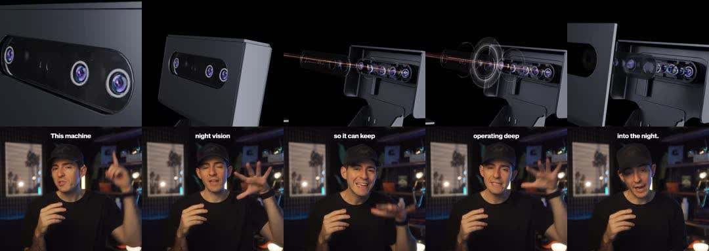

# v20_s35 · split_graphic · 71.7–75.8s (calidad 3)

- **Guion:** This machine even has night vision so it can keep operating deep into the night.
- **Qué se ve:** Split. Arriba render del módulo de cámaras: lente, despiece con anillos y un haz anaranjado. Subtítulos «This machine / even has / night vision / so it can keep / operating deep / into the night.»
- **Diseño:** Pantalla dividida (costura en y≈50.3% del alto): arriba motion graphic / render 3D a sangre, abajo él en plano medio. Subtítulo pequeño: sans geométrica bold (tipo Aeonik/Satoshi bold), blanco #FFFFFF, minúsculas tipo frase, ≈30 px de cuerpo sobre 720 px de ancho (bloque de 22 px de alto), centrado en X, 1–3 palabras por bloque justo bajo la costura (centro y≈54 %).
- **Efectos:** Material del video promocional del fabricante (render 3D con rótulos en chino); se intuye re-rotulado en inglés encima.
- **Animación:** Corte seco de entrada y salida; el gráfico trae su animación propia (cámara 3D, texto que entra, líneas que se dibujan).
- **Por qué aquí:** «night vision» → sensor con haz de luz sobre negro.
