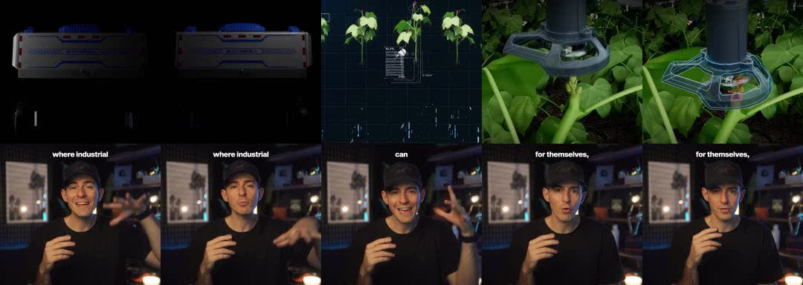

# v20_s37 · split_graphic · 77.8–80.8s (calidad 3)

- **Guion:** industrial machines can think for themselves.
- **Qué se ve:** Split. Arriba el frontal de la máquina que se funde a negro, el HUD de plantas y el anillo cortador. Subtítulos «where industrial / machines / think / for themselves,».
- **Diseño:** Pantalla dividida (costura en y≈50.3% del alto): arriba motion graphic / render 3D a sangre, abajo él en plano medio. Subtítulo pequeño: sans geométrica bold (tipo Aeonik/Satoshi bold), blanco #FFFFFF, minúsculas tipo frase, ≈30 px de cuerpo sobre 720 px de ancho (bloque de 22 px de alto), centrado en X, 1–3 palabras por bloque justo bajo la costura (centro y≈54 %).
- **Efectos:** Material del video promocional del fabricante (render 3D con rótulos en chino); se intuye re-rotulado en inglés encima.
- **Animación:** Corte seco de entrada y salida; el gráfico trae su animación propia (cámara 3D, texto que entra, líneas que se dibujan).
- **Por qué aquí:** «machines can think for themselves» → repaso de las tres imágenes de «pensar» ya vistas (recapitulación).
