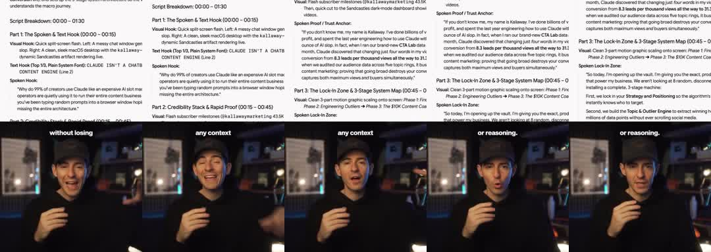

# v06_s16 · split_headline · 22.6–25.1s (calidad 4)

- **Guion:** losing any context or reasoning.
- **Qué se ve:** Arriba: documento de texto generado («Script Breakdown: 00:00 – 01:30», «Part 1: The Spoken & Text Hook…», «Part 2: Credibility Stack…») que avanza a saltos.
- **Diseño:** Texto negro sans pequeña sobre blanco, títulos en negrita. Subtítulo blanco sans bold (tipo Inter), 1–3 palabras, ~30 px sobre 720 (≈2,3 % del alto), centrado, y≈52,7 % (≈58 px bajo la costura, que está en y≈48,1 %); sin caja
- **Efectos:** Set oscuro con luces cian y ámbar desenfocadas; sin textura añadida
- **Animación:** Corte seco; scroll escalonado (stop-motion) cada ~5 fotogramas
- **Por qué aquí:** «Without losing any context or reasoning» → un documento largo y coherente como prueba
