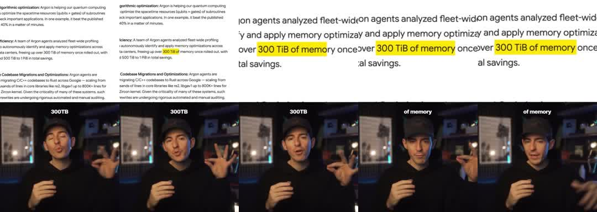

# v06_s34 · split_headline · 60.0–62.0s (calidad 5)

- **Guion:** terabytes of memory across
- **Qué se ve:** Arriba: texto del blog ampliado; un resaltado amarillo barre «300 TiB of memory».
- **Diseño:** Texto gris oscuro sans regular sobre blanco; resaltado amarillo marcador (#FFE600 aprox.). Subtítulo blanco sans bold (tipo Inter), 1–3 palabras, ~30 px sobre 720 (≈2,3 % del alto), centrado, y≈52,7 % (≈58 px bajo la costura, que está en y≈48,1 %); sin caja (subtítulo «300TB»)
- **Efectos:** Set oscuro con luces cian y ámbar desenfocadas; sin textura añadida
- **Animación:** Corte seco; zoom-in ≈0,4 s; barrido del resaltado ≈0,6 s
- **Por qué aquí:** Dato + fuente: la cifra dicha se subraya en el texto oficial
