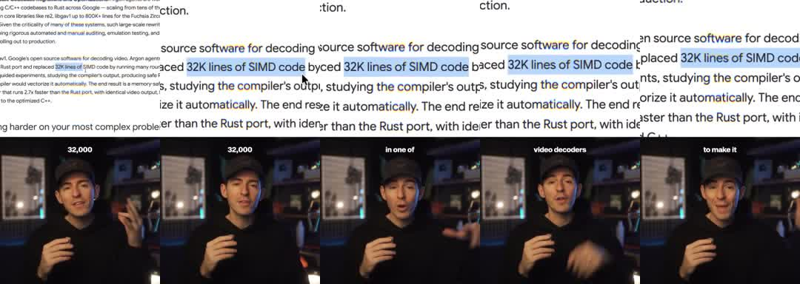

# v06_s37 · split_headline · 65.6–69.8s (calidad 4)

- **Guion:** ,000 lines of code in one of Google's video decoders to make it
- **Qué se ve:** Arriba: texto del blog; zoom hasta «32K lines of SIMD code» seleccionado en azul claro, con cursor de flecha.
- **Diseño:** Texto gris oscuro; selección azul claro (#BBD6FB aprox.); cursor negro. Subtítulo blanco sans bold (tipo Inter), 1–3 palabras, ~30 px sobre 720 (≈2,3 % del alto), centrado, y≈52,7 % (≈58 px bajo la costura, que está en y≈48,1 %); sin caja (subtítulo «32,000»)
- **Efectos:** Set oscuro con luces cian y ámbar desenfocadas; sin textura añadida
- **Animación:** Corte seco; zoom-in ≈0,35 s; luego deriva lenta
- **Por qué aquí:** Dato + fuente con selección de ratón (variación del resaltado amarillo)
