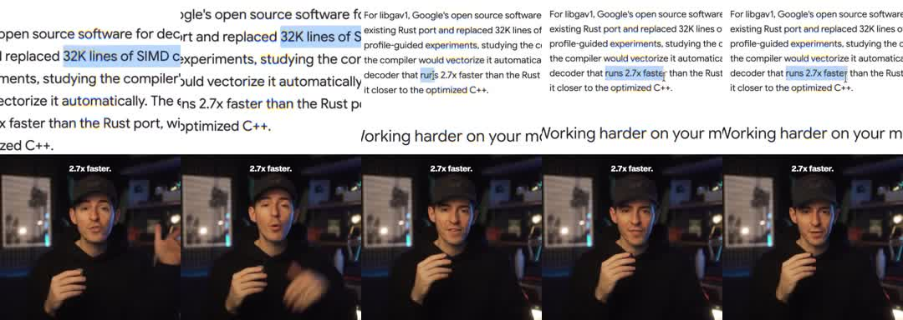

# v06_s38 · split_headline · 69.8–71.5s (calidad 4)

- **Guion:** 2 .7 times faster.
- **Qué se ve:** Arriba: la vista se aleja y recoloca hasta «runs 2.7x faster than the Rust port», resaltado en azul.
- **Diseño:** Subtítulo blanco sans bold (tipo Inter), 1–3 palabras, ~30 px sobre 720 (≈2,3 % del alto), centrado, y≈52,7 % (≈58 px bajo la costura, que está en y≈48,1 %); sin caja (subtítulo «2.7x faster.»)
- **Efectos:** Set oscuro con luces cian y ámbar desenfocadas; sin textura añadida
- **Animación:** Movimiento continuo dentro de la captura, sin corte; sale por corte seco a 71.53
- **Por qué aquí:** Segunda cifra en el mismo documento: un solo movimiento une los dos datos
