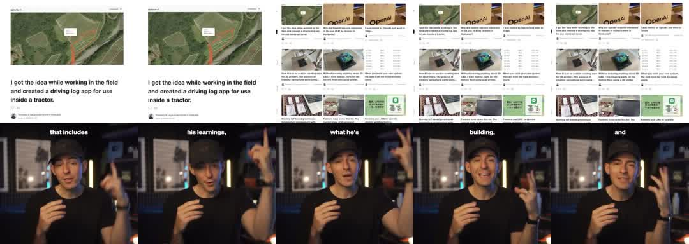

# v09_s27 · split_headline · 56.8–59.1s (calidad 4)

- **Guion:** includes his learnings, what he's building, and step
- **Qué se ve:** Arriba un post concreto ('I got the idea while working in the field and created a driving log app for use inside a tractor.') y luego de nuevo la rejilla.
- **Diseño:** Split 50/50: captura web a sangre en la mitad superior (sin marco ni sombra), él abajo plano medio. Subtítulo: sans geométrica bold blanca, minúsculas con puntuación, ≈30 px de alto de letra sobre 720 px de ancho, centrado en x, 1–3 palabras, justo bajo la costura (y≈54 %).
- **Efectos:** Sin grano, papel ni halftone añadidos. A-roll: set oscuro, viñeta natural, prácticos cálidos y tubo/luz cian al fondo. Mitad superior sin filtros: el material conserva su color original (contraste fuerte con el set oscuro de abajo).
- **Animación:** La mitad superior entra por corte seco (1 fotograma) sincronizada con la palabra; los cambios internos también son cortes secos; el único movimiento es el propio del material (cámara del clip, scroll o zoom lento). La mitad inferior no corta (toma continua). Subtítulo por sustitución instantánea cada 1–3 palabras.
- **Por qué aquí:** 'his learnings, what he's building': ejemplos concretos de contenido de la web.
