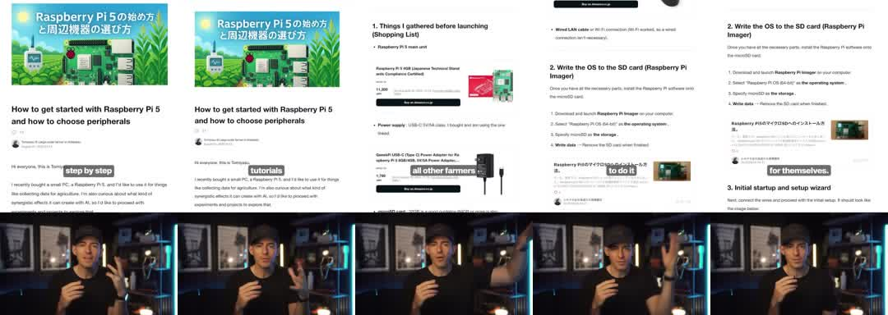

# v09_s28 · split_headline · 59.1–63.1s (calidad 4)

- **Guion:** -by-step tutorials for all other farmers that wanna do it for themselves.
- **Qué se ve:** Arriba (2/3) el tutorial 'How to get started with Raspberry Pi 5 and how to choose peripherals' haciendo scroll por la lista de compra; subtítulos en caja sobre la página.
- **Diseño:** Split 66/34: captura web a sangre en la mitad superior (sin marco ni sombra), él abajo plano medio. Subtítulo: sans geométrica bold blanca, minúsculas con puntuación, ≈30 px de alto de letra sobre 720 px de ancho, centrado en x, 1–3 palabras, sobre la propia captura con caja gris translúcida redondeada (y≈62 %).
- **Efectos:** Sin grano, papel ni halftone añadidos. A-roll: set oscuro, viñeta natural, prácticos cálidos y tubo/luz cian al fondo. Mitad superior sin filtros: el material conserva su color original (contraste fuerte con el set oscuro de abajo).
- **Animación:** La mitad superior entra por corte seco (1 fotograma) sincronizada con la palabra; los cambios internos también son cortes secos; el único movimiento es el propio del material (cámara del clip, scroll o zoom lento). La mitad inferior no corta (toma continua). Subtítulo por sustitución instantánea cada 1–3 palabras.
- **Por qué aquí:** 'step-by-step tutorials for all other farmers': enseñar el tutorial real = generosidad del personaje (payoff emocional).
