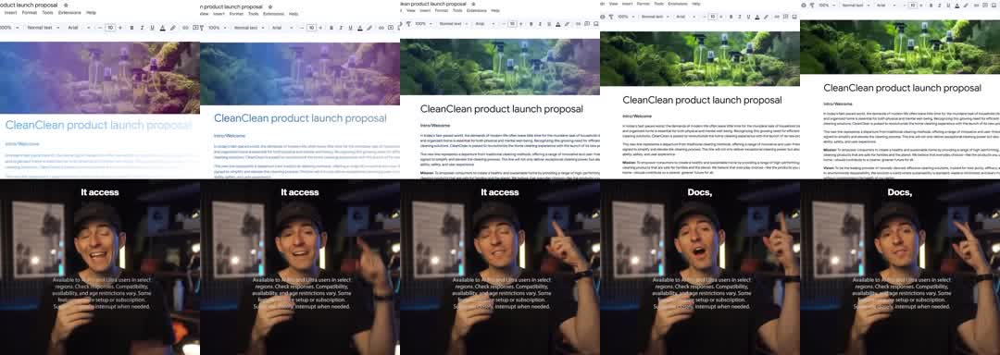

# v13_s09 · split_headline · 14.4–15.4s (calidad 3)

- **Guion:** It can access docs,
- **Qué se ve:** Arriba un Google Doc («CleanClean product launch proposal», con imagen de cabecera verde y barra de herramientas). Abajo él; subtítulo «It access», «Docs,». Aparece texto legal pequeño sobre su pecho.
- **Diseño:** Pantalla dividida: evidencia arriba (0–50 %), él abajo en set oscuro (gorra y camiseta negras, luces naranja/cian desenfocadas). Costura recta sin borde en y≈645 px de 1280 (50,4 %). Subtítulo: sans geométrica bold blanca (tipo Inter/Helvetica Now Bold), minúsculas con mayúscula inicial de frase, ~30 px de alto de fuente sobre 720 px de ancho, 1–3 palabras, centrado en x, sombra negra suave. Subtítulo en y≈693 px (54 %), justo bajo la costura, sobre su gorra. Arriba: captura clara (fondo blanco) de documento/correo.
- **Efectos:** Sin texturas.
- **Animación:** Zoom/scroll lento; corte seco.
- **Por qué aquí:** Enumeración: cada app nombrada = su captura. El aviso legal revela que es contenido patrocinado.
