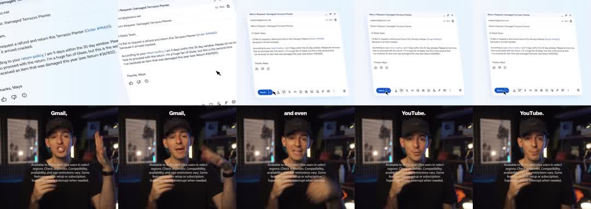

# v13_s12 · split_headline · 17.3–18.6s (calidad 3)

- **Guion:** Gmail, and even YouTube.
- **Qué se ve:** Arriba ventana de redacción de Gmail en blanco («Return Request: Damaged Terrazzo Planter») inclinada, con un cursor que baja hacia el botón azul Enviar. Subtítulos «Gmail,» y «YouTube.».
- **Diseño:** Pantalla dividida: evidencia arriba (0–50 %), él abajo en set oscuro (gorra y camiseta negras, luces naranja/cian desenfocadas). Costura recta sin borde en y≈645 px de 1280 (50,4 %). Subtítulo: sans geométrica bold blanca (tipo Inter/Helvetica Now Bold), minúsculas con mayúscula inicial de frase, ~30 px de alto de fuente sobre 720 px de ancho, 1–3 palabras, centrado en x, sombra negra suave. Subtítulo en y≈693 px (54 %), justo bajo la costura, sobre su gorra. Arriba: captura clara (fondo blanco) de documento/correo.
- **Efectos:** Sin texturas.
- **Animación:** Zoom/scroll lento; corte seco.
- **Por qué aquí:** Cierra la lista de apps; el aviso legal sigue abajo hasta el corte.
