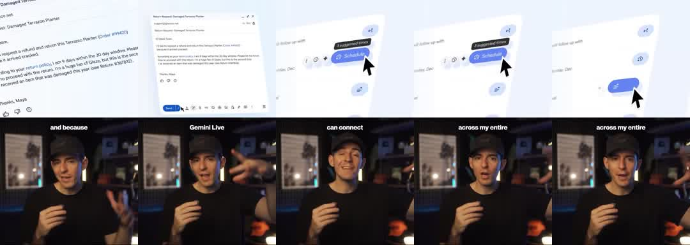

# v13_s47 · split_headline · 100.9–103.6s (calidad 3)

- **Guion:** And because Gemini Live can connect across my entire
- **Qué se ve:** Arriba un correo de Gmail en blanco con perspectiva, que hace panorámica rápida hasta los botones «3 suggested times» / «Schedule» con un cursor negro grande. Abajo él. Subtítulos «and because», «Gemini Live», «can connect», «across my entire».
- **Diseño:** Pantalla dividida: evidencia arriba (0–50 %), él abajo en set oscuro (gorra y camiseta negras, luces naranja/cian desenfocadas). Costura recta sin borde en y≈645 px de 1280 (50,4 %). Subtítulo: sans geométrica bold blanca (tipo Inter/Helvetica Now Bold), minúsculas con mayúscula inicial de frase, ~30 px de alto de fuente sobre 720 px de ancho, 1–3 palabras, centrado en x, sombra negra suave. Subtítulo en y≈693 px (54 %), justo bajo la costura, sobre su gorra. Arriba: captura clara (fondo blanco) de documento/correo.
- **Efectos:** Sin texturas.
- **Animación:** Zoom/scroll lento; corte seco.
- **Por qué aquí:** «conecta con toda mi suite de Google» → Gmail con acciones de IA.
