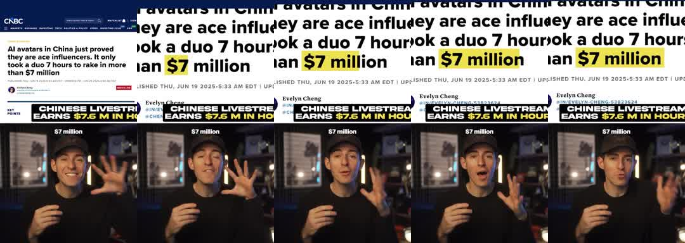

# v15_s02 · split_headline · 1.3–2.4s (calidad 5)

- **Guion:** $7 million worth
- **Qué se ve:** Arriba artículo de CNBC: «AI avatars in China just proved they are ace influencers: It only took a duo 7 hours to rake in more than $7 million»; a los 0,25 s corta a un zoom del titular con «$7 million» resaltado en amarillo y la línea de fecha/autora. La franja negra sigue encima.
- **Diseño:** Pantalla dividida: evidencia arriba, él abajo en set oscuro (gorra y camiseta negras, tubo de luz cálida a la derecha). Costura recta sin borde en y=649 px de 1280 (50,7 %). Subtítulo: sans bold blanca (tipo Inter/Helvetica Now Bold) ~30 px de alto de fuente sobre 720 px de ancho, 1–3 palabras, centrado en x, sombra negra suave. Subtítulo en y≈693 px (54 %), justo bajo la costura. Arriba: captura de artículo (fondo blanco, titular sans bold negro) con resaltado amarillo.
- **Efectos:** Resaltado amarillo plano (~#F5E04A) detrás de la cifra.
- **Animación:** Corte interno de página completa a zoom del titular (0,25 s después); corte seco.
- **Por qué aquí:** Prueba de autoridad en el segundo 1: la cifra dicha coincide con la cifra resaltada en un medio conocido.
