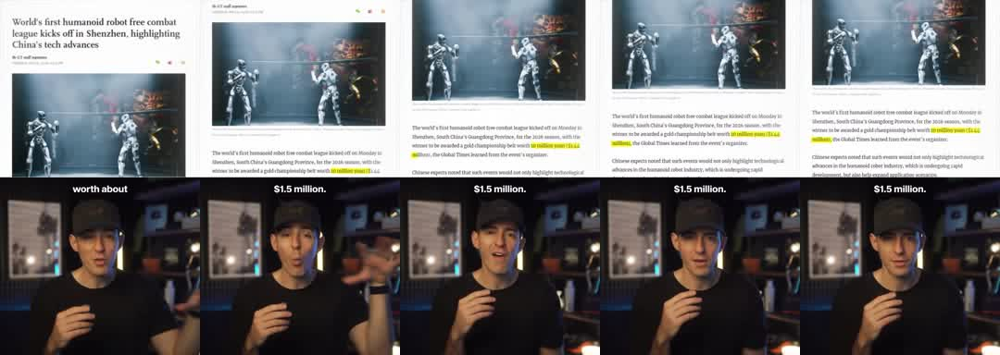

# v18_s20 · split_headline · 39.9–42.0s (calidad 5)

- **Guion:** about $1.5 million. To
- **Qué se ve:** Split. Arriba artículo de prensa en blanco (titular «World's first humanoid robot free combat league kicks off in Shenzhen…», foto de dos robots) que baja por pasos hasta el párrafo con «10 million yuan ($1.44 million)» resaltado en amarillo. Subtítulos «worth about / $1.5 million.»
- **Diseño:** Pantalla dividida (costura en y≈49.8% del alto): arriba captura de artículo a sangre (fondo blanco, titular serif negro), abajo él en plano medio. Subtítulo pequeño: sans geométrica bold (tipo Aeonik/Satoshi bold), blanco #FFFFFF, minúsculas tipo frase, ≈30 px de cuerpo sobre 720 px de ancho (bloque de 22 px de alto), centrado en X, 1–3 palabras por bloque bajo la costura (centro y≈54 %).
- **Efectos:** Resaltado amarillo tipo marcador (#F5E642 aprox.) sobre el texto clave; sin grano.
- **Animación:** Entra por corte seco; el resaltado amarillo barre de izquierda a derecha; la captura hace scroll/zoom a pasos. Sale por corte seco. El scroll avanza en escalones de ~2–3 fotogramas (detección de corte cada 0.07–0.10 s entre 40.0 y 41.2).
- **Por qué aquí:** Cifra de dinero → fuente escrita con resaltado amarillo: credibilidad («no me lo invento»).
