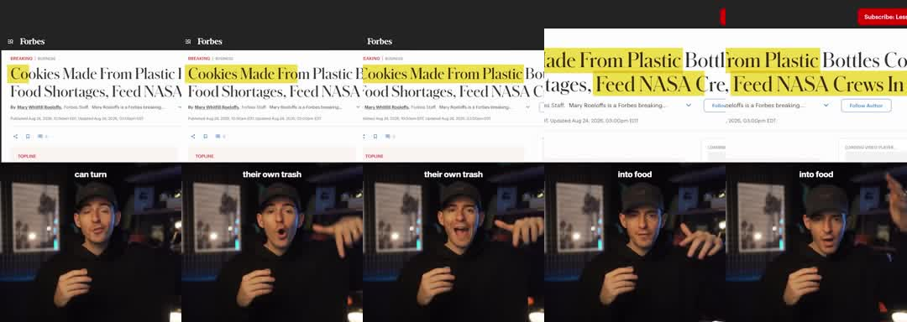

# v19_s09 · split_headline · 15.5–17.8s (calidad 5)

- **Guion:** turn their own trash into food on
- **Qué se ve:** Split. Arriba artículo de Forbes: «Cookies Made From Plastic Bottles Could Solve Food Shortages, Feed NASA Crews In…» con resaltado amarillo que avanza palabra a palabra; a los 17.0 acerca a «Feed NASA Crews». Subtítulos «can turn / their own trash / into food».
- **Diseño:** Pantalla dividida (costura en y≈50.3% del alto): arriba captura de artículo a sangre (fondo blanco, titular serif negro), abajo él en plano medio. Subtítulo pequeño: sans geométrica bold (tipo Aeonik/Satoshi bold), blanco #FFFFFF, minúsculas tipo frase, ≈30 px de cuerpo sobre 720 px de ancho (bloque de 22 px de alto), centrado en X, 1–3 palabras por bloque bajo la costura (centro y≈54 %).
- **Efectos:** Resaltado amarillo tipo marcador (#F5E642 aprox.) sobre el texto clave; sin grano.
- **Animación:** Entra por corte seco; el resaltado amarillo barre de izquierda a derecha; la captura hace scroll/zoom a pasos. Sale por corte seco. Barrido del resaltado ≈1.4 s; zoom por corte a 16.98.
- **Por qué aquí:** Afirmación increíble → titular de medio reconocido con resaltado: credibilidad en el momento de más duda.
