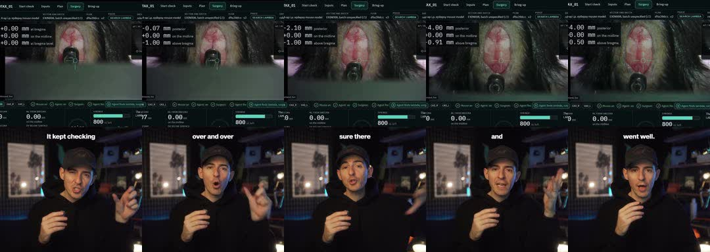

# v01_s31 · split_screenrec · 53.8–58.6s (calidad 4)

- **Guion:** It kept checking the camera over and over to make sure there wasn't extra bleeding and the operation went well. Now
- **Qué se ve:** Arriba: vista de cámara de la cirugía con lecturas que cambian (−0.07 → −4.00 mm posterior). Subtítulo de 2–3 palabras ('It kept checking', 'the camera', 'over and over'…).
- **Diseño:** Pantalla dividida 50/50. Arriba interfaz oscura verde-azulada (#0C1A1C aprox.) con tipografía monoespaciada y acentos cian/menta (#5ED3C0 aprox.). Abajo él en plano medio. Subtítulo blanco, sans geométrica bold en minúsculas/caja normal (tipo Gilroy/Satoshi; fuente exacta desconocida), 1–3 palabras, centrado en x=50 %, centro en y≈54 % (≈692 px de 1280), altura de minúscula+ascendente ≈22 px (≈1.7 % del alto), sombra suave oscura.
- **Efectos:** Sin texturas; la interfaz tiene su propio desenfoque/censura sobre parte de la imagen de cámara (banda gris translúcida).
- **Animación:** Corte seco. Dentro de la captura los números cambian y la imagen de la cámara deriva lentamente; no se ve zoom añadido por el editor.
- **Por qué aquí:** 'Revisaba la cámara' → se ve la cámara casi 5 s, el plano más largo del video.
