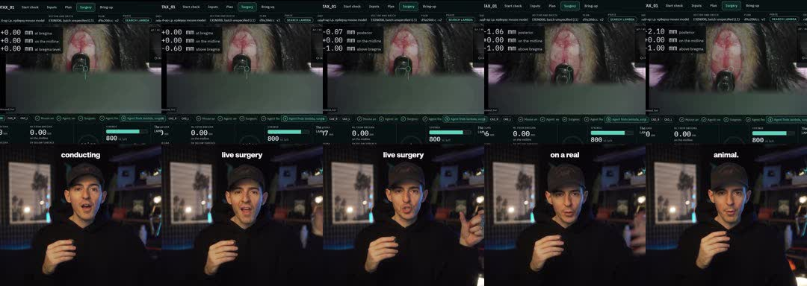

# v01_s43 · split_screenrec · 71.4–74.0s (calidad 4)

- **Guion:** live surgery on a real animal.
- **Qué se ve:** Arriba: cámara de la cirugía con lecturas avanzando. Subtítulo 'conducting' / 'live surgery' / 'on a real' / 'animal.'.
- **Diseño:** Pantalla dividida 50/50. Arriba interfaz oscura verde-azulada (#0C1A1C aprox.) con tipografía monoespaciada y acentos cian/menta (#5ED3C0 aprox.). Abajo él en plano medio. Subtítulo blanco, sans geométrica bold en minúsculas/caja normal (tipo Gilroy/Satoshi; fuente exacta desconocida), 1–3 palabras, centrado en x=50 %, centro en y≈54 % (≈692 px de 1280), altura de minúscula+ascendente ≈22 px (≈1.7 % del alto), sombra suave oscura.
- **Efectos:** Sin texturas; la interfaz tiene su propio desenfoque/censura sobre parte de la imagen de cámara (banda gris translúcida).
- **Animación:** Corte seco. Dentro de la captura los números cambian y la imagen de la cámara deriva lentamente; no se ve zoom añadido por el editor.
- **Por qué aquí:** 'Cirugía en vivo' → la cámara de la cirugía otra vez.
