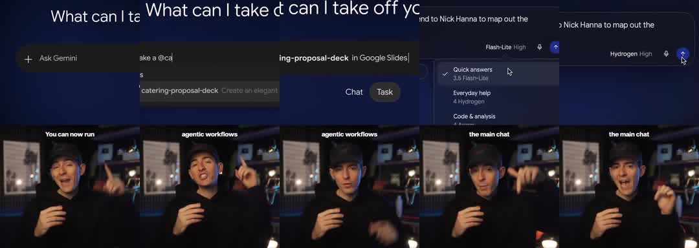

# v02_s01 · split_screenrec · 0.0–3.1s (calidad 4)

- **Guion:** You can now run agentic workflows straight from the main chat in
- **Qué se ve:** Arriba: caja de texto de Gemini ('What can I take off…', 'Ask Gemini') donde se teclea 'make a @catering-proposal-deck in Go…'; luego el selector de modelo abre un desplegable (Quick answers / Everyday help / Code & analysis). Abajo: él. Subtítulo 'You can now run' / 'agentic workflows' / 'straight from' / 'the main chat'.
- **Diseño:** Pantalla dividida 50/50. Arriba grabación de pantalla de Gemini / Google Workspace MUY ampliada (el texto de la interfaz ocupa todo el ancho; solo se ve un fragmento de la UI). Abajo él en plano medio. Subtítulo blanco, sans geométrica bold (fuente exacta desconocida), 1–3 palabras, centrado en x=50 %, y≈54 % (justo bajo la costura), altura ≈22 px sobre 1280, sombra suave.
- **Efectos:** Sin texturas; fondos de interfaz azul noche (#0B1030 aprox.), negro o lila claro (#E6E4FA aprox.).
- **Animación:** Corte seco de entrada. Dentro: cursor que se mueve y hace clic, texto que se teclea, y panes/zooms de la captura siguiendo la zona activa.
- **Por qué aquí:** Abre directamente con el producto en uso: el gancho es ver la función, no un titular.
