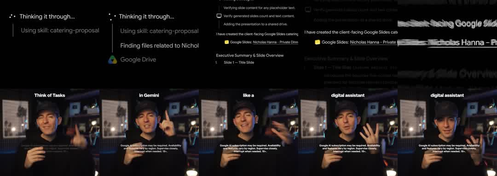

# v02_s07 · split_screenrec · 8.8–11.2s (calidad 4)

- **Guion:** Think of tasks in Gemini like a digital assistant that
- **Qué se ve:** Arriba: 'Thinking it through… / Using skill: catering-proposal / Finding files related to Nichol…' y después el resultado ('I have created the client-facing Google Slides…') desplazándose. Abajo aparece el aviso legal pequeño. Subtítulo 'Think of Tasks' / 'in Gemini' / 'digital assistant'.
- **Diseño:** Pantalla dividida 50/50. Arriba grabación de pantalla de Gemini / Google Workspace MUY ampliada (el texto de la interfaz ocupa todo el ancho; solo se ve un fragmento de la UI). Abajo él en plano medio. Subtítulo blanco, sans geométrica bold (fuente exacta desconocida), 1–3 palabras, centrado en x=50 %, y≈54 % (justo bajo la costura), altura ≈22 px sobre 1280, sombra suave. En 8.76–13.39 y 83.76–87.12 hay además un aviso legal blanco muy pequeño de 3 líneas centrado en y≈71 % ('Google AI subscription may be required. Availability and features vary by region. Supervise closely, interrupt when needed. 18+.').
- **Efectos:** Sin texturas; fondos de interfaz azul noche (#0B1030 aprox.), negro o lila claro (#E6E4FA aprox.).
- **Animación:** Corte seco de entrada. Dentro: cursor que se mueve y hace clic, texto que se teclea, y panes/zooms de la captura siguiendo la zona activa.
- **Por qué aquí:** 'Asistente digital' → se ve al asistente pensando y entregando.
