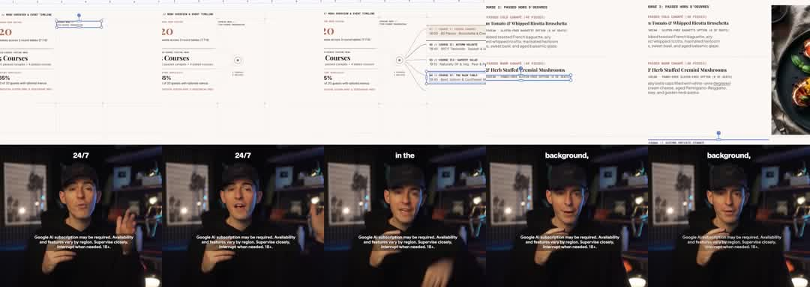

# v02_s09 · split_screenrec · 11.9–13.4s (calidad 3)

- **Guion:** -7 in the background,
- **Qué se ve:** Arriba: documento claro con secciones y un diagrama de líneas hacia una tarjeta, luego foto de un plato. Subtítulo '24/7' / 'in the' / 'background,'.
- **Diseño:** Pantalla dividida 50/50. Arriba grabación de pantalla de Gemini / Google Workspace MUY ampliada (el texto de la interfaz ocupa todo el ancho; solo se ve un fragmento de la UI). Abajo él en plano medio. Subtítulo blanco, sans geométrica bold (fuente exacta desconocida), 1–3 palabras, centrado en x=50 %, y≈54 % (justo bajo la costura), altura ≈22 px sobre 1280, sombra suave.
- **Efectos:** Sin texturas; fondos de interfaz azul noche (#0B1030 aprox.), negro o lila claro (#E6E4FA aprox.).
- **Animación:** Corte seco de entrada. Dentro: cursor que se mueve y hace clic, texto que se teclea, y panes/zooms de la captura siguiendo la zona activa.
- **Por qué aquí:** Más entregables mientras habla de trabajar en segundo plano.
