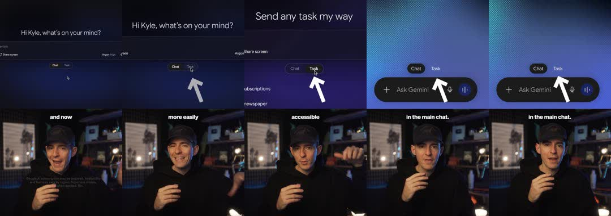

# v02_s10 · split_screenrec · 13.4–16.5s (calidad 5)

- **Guion:** and now more easily accessible directly in the main chat.
- **Qué se ve:** Arriba: inicio de Gemini 'Hi Kyle, what's on your mind?'; la captura se acerca al conmutador Chat/Task y aparece una FLECHA blanca grande apuntando a 'Task'; a 15.02 cambia a fondo azul con la caja 'Ask Gemini' y la flecha. Subtítulo 'and now' / 'more easily' / 'accessible' / 'directly' / 'in the main chat.'.
- **Diseño:** Pantalla dividida 50/50. Arriba grabación de pantalla de Gemini / Google Workspace MUY ampliada (el texto de la interfaz ocupa todo el ancho; solo se ve un fragmento de la UI). Abajo él en plano medio. Subtítulo blanco, sans geométrica bold (fuente exacta desconocida), 1–3 palabras, centrado en x=50 %, y≈54 % (justo bajo la costura), altura ≈22 px sobre 1280, sombra suave.
- **Efectos:** Sin texturas; fondos de interfaz azul noche (#0B1030 aprox.), negro o lila claro (#E6E4FA aprox.).
- **Animación:** Corte seco de entrada. Dentro: cursor que se mueve y hace clic, texto que se teclea, y panes/zooms de la captura siguiendo la zona activa.
- **Por qué aquí:** Enseña DÓNDE está la función: flecha grande para que nadie se pierda.
