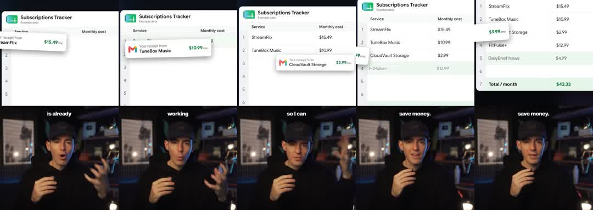

# v02_s18 · split_screenrec · 30.9–32.7s (calidad 5)

- **Guion:** already working so I can save money.
- **Qué se ve:** Arriba: hoja 'Subscriptions Tracker' (StreamFlix $15.49, TuneBox Music $10.99, CloudVault Storage $2.99…) con tarjetas de recibos de Gmail que caen sobre las filas. Subtítulo 'is already' / 'so I can' / 'save money.'.
- **Diseño:** Pantalla dividida 50/50. Arriba grabación de pantalla de Gemini / Google Workspace MUY ampliada (el texto de la interfaz ocupa todo el ancho; solo se ve un fragmento de la UI). Abajo él en plano medio. Subtítulo blanco, sans geométrica bold (fuente exacta desconocida), 1–3 palabras, centrado en x=50 %, y≈54 % (justo bajo la costura), altura ≈22 px sobre 1280, sombra suave.
- **Efectos:** Sin texturas; fondos de interfaz azul noche (#0B1030 aprox.), negro o lila claro (#E6E4FA aprox.).
- **Animación:** Corte seco de entrada. Dentro: cursor que se mueve y hace clic, texto que se teclea, y panes/zooms de la captura siguiendo la zona activa.
- **Por qué aquí:** 'Ahorrar dinero' → precios y hoja de suscripciones.
