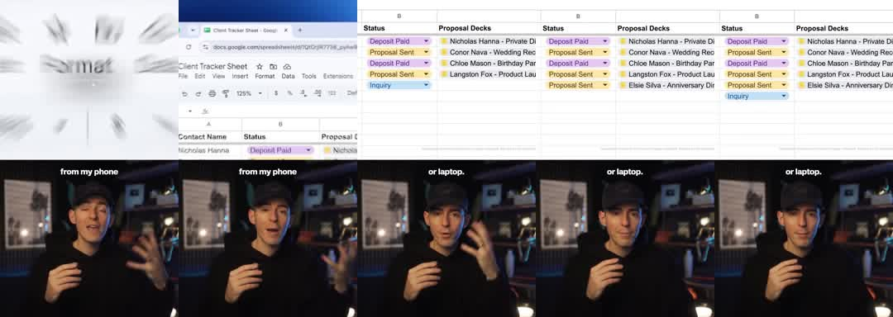

# v02_s22 · split_screenrec · 36.2–37.8s (calidad 4)

- **Guion:** from my phone or laptop.
- **Qué se ve:** Arriba: Google Sheets 'Client Tracker Sheet' tras un zoom borroso radial; a 36.91 corte a la tabla ampliada con estados de colores. Subtítulo 'from my phone' / 'or laptop.'.
- **Diseño:** Pantalla dividida 50/50. Arriba grabación de pantalla de Gemini / Google Workspace MUY ampliada (el texto de la interfaz ocupa todo el ancho; solo se ve un fragmento de la UI). Abajo él en plano medio. Subtítulo blanco, sans geométrica bold (fuente exacta desconocida), 1–3 palabras, centrado en x=50 %, y≈54 % (justo bajo la costura), altura ≈22 px sobre 1280, sombra suave.
- **Efectos:** Sin texturas; fondos de interfaz azul noche (#0B1030 aprox.), negro o lila claro (#E6E4FA aprox.).
- **Animación:** Corte seco de entrada. Dentro: cursor que se mueve y hace clic, texto que se teclea, y panes/zooms de la captura siguiendo la zona activa.
- **Por qué aquí:** Único efecto de transición vistoso del video: marca el salto a otro dispositivo/ventana.
