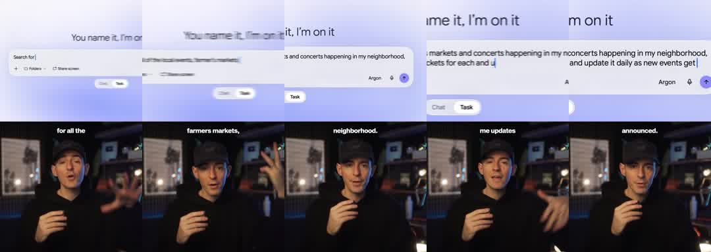

# v02_s46 · split_screenrec · 63.8–72.4s (calidad 5)

- **Guion:** search for all the local events, farmers, markets and concerts happening in my neighborhood, build a Google sheet with links for each and send me updates anytime new things are announced.
- **Qué se ve:** Arriba: interfaz lila clara 'You name it, I'm on it' con el prompt escribiéndose al ritmo de la voz ('Search for all of the local events, farmer's markets and concerts happening in my neighborhood, build a Google Sheet with links to book tickets for each and update it daily as new events get…'). Subtítulo de 1–3 palabras.
- **Diseño:** Pantalla dividida 50/50. Arriba grabación de pantalla de Gemini / Google Workspace MUY ampliada (el texto de la interfaz ocupa todo el ancho; solo se ve un fragmento de la UI). Abajo él en plano medio. Subtítulo blanco, sans geométrica bold (fuente exacta desconocida), 1–3 palabras, centrado en x=50 %, y≈54 % (justo bajo la costura), altura ≈22 px sobre 1280, sombra suave.
- **Efectos:** Sin texturas; fondos de interfaz azul noche (#0B1030 aprox.), negro o lila claro (#E6E4FA aprox.).
- **Animación:** Corte seco de entrada. Dentro: cursor que se mueve y hace clic, texto que se teclea, y panes/zooms de la captura siguiendo la zona activa.
- **Por qué aquí:** Lee el prompt y lo ves escribirse: 8.5 s sin cortar porque el texto ya es movimiento.
