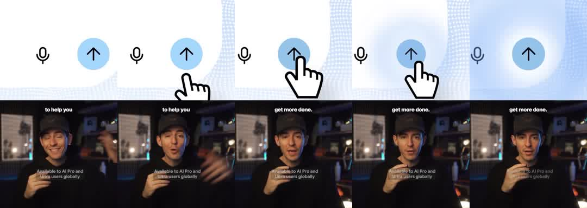

# v06_s07 · split_screenrec · 7.4–8.7s (calidad 4)

- **Guion:** help you get more done.
- **Qué se ve:** Arriba: primerísimo plano del botón azul de enviar (flecha hacia arriba) y el icono de micrófono; un cursor de mano sube y hace clic.
- **Diseño:** Botón circular azul claro (#A8D0F5 aprox.) con flecha negra, fondo blanco con trama de puntos azul; cursor de mano con contorno negro. Subtítulo blanco sans bold (tipo Inter), 1–3 palabras, ~30 px sobre 720 (≈2,3 % del alto), centrado, y≈52,7 % (≈58 px bajo la costura, que está en y≈48,1 %); sin caja. Sobre su pecho, texto legal gris semitransparente en 2 líneas «Available to AI Pro and Ultra users globally» (y≈83 %, sans regular ~24 px).
- **Efectos:** Halo azul que se expande tras el clic
- **Animación:** Corte seco de entrada y salida (1 fotograma); cursor entra a 7.9 y pulsa a ≈8.4
- **Por qué aquí:** «Help you get more done» → la acción de enviar: un clic = trabajo hecho
