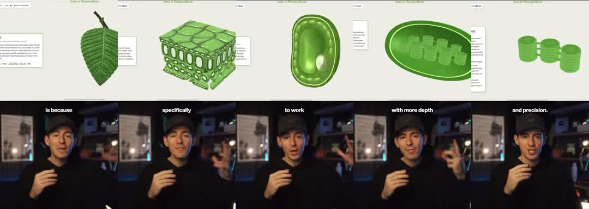

# v06_s13 · split_screenrec · 14.5–18.5s (calidad 5)

- **Guion:** because it was specifically designed to work with more depth and precision.
- **Qué se ve:** Arriba: documento interactivo sobre fotosíntesis: hoja verde 3D con panel de texto a la izquierda; zoom dentro de la hoja a un corte de tejido, luego a un cloroplasto y a pilas de tilacoides.
- **Diseño:** Fondo gris muy claro, modelos verdes translúcidos, panel de texto pequeño a la izquierda. Subtítulo blanco sans bold (tipo Inter), 1–3 palabras, ~30 px sobre 720 (≈2,3 % del alto), centrado, y≈52,7 % (≈58 px bajo la costura, que está en y≈48,1 %); sin caja
- **Efectos:** Set oscuro con luces cian y ámbar desenfocadas; sin textura añadida
- **Animación:** Corte seco de entrada; dentro, zooms con fundido de ~0,3 s entre niveles
- **Por qué aquí:** «Designed to work with more depth and precision» → metáfora visual literal: cada vez más profundo y más preciso
