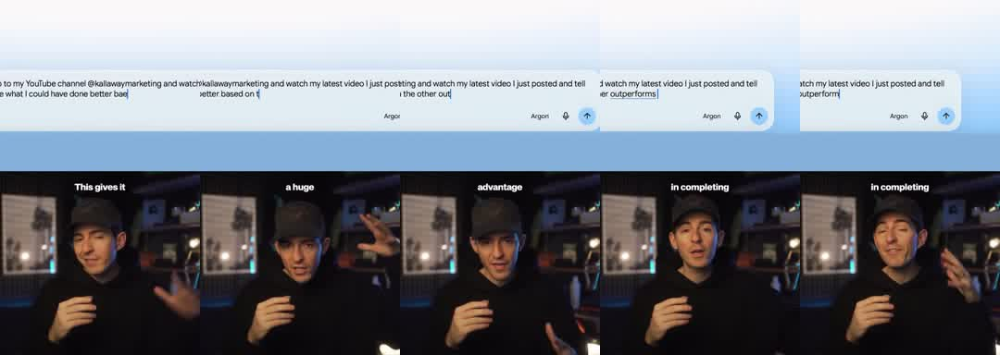

# v06_s14 · split_screenrec · 18.5–20.5s (calidad 4)

- **Guion:** This gives it a huge advantage in completing very
- **Qué se ve:** Arriba: caja de prompt de Gemini con texto escribiéndose («…go to my YouTube channel @kallawaymarketing and watch my latest video… outperform|»), selector «Argon», micrófono y botón de enviar.
- **Diseño:** Caja blanca redondeada sobre degradado azul claro; texto gris oscuro sans regular. Subtítulo blanco sans bold (tipo Inter), 1–3 palabras, ~30 px sobre 720 (≈2,3 % del alto), centrado, y≈52,7 % (≈58 px bajo la costura, que está en y≈48,1 %); sin caja
- **Efectos:** Set oscuro con luces cian y ámbar desenfocadas; sin textura añadida
- **Animación:** Corte seco de entrada y salida (1 fotograma); tecleo en vivo + paneo suave
- **Por qué aquí:** «This gives it a huge advantage in completing…» → se ve una petición larga real
