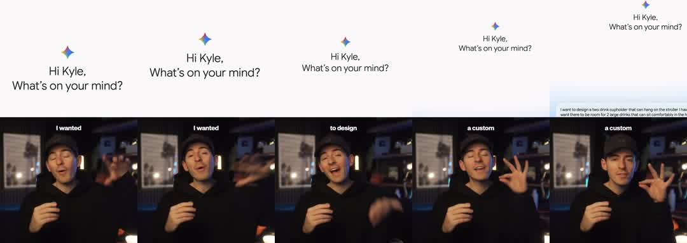

# v06_s18 · split_screenrec · 25.5–27.0s (calidad 4)

- **Guion:** I wanted to design a custom
- **Qué se ve:** Arriba: pantalla de inicio de Gemini «Hi Kyle, What's on your mind?» con la estrella de colores; la vista se desplaza hacia abajo hasta la caja de prompt.
- **Diseño:** Fondo blanco, saludo centrado en sans regular gris oscuro, estrella Gemini de 4 colores. Subtítulo blanco sans bold (tipo Inter), 1–3 palabras, ~30 px sobre 720 (≈2,3 % del alto), centrado, y≈52,7 % (≈58 px bajo la costura, que está en y≈48,1 %); sin caja
- **Efectos:** Set oscuro con luces cian y ámbar desenfocadas; sin textura añadida
- **Animación:** Corte seco de entrada y salida (1 fotograma); scroll suave ≈1 s
- **Por qué aquí:** «I wanted to design…» → empieza la demo desde la pantalla vacía (credibilidad: es su cuenta, «Hi Kyle»)
