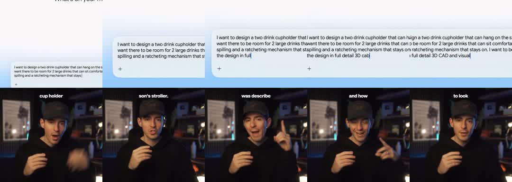

# v06_s19 · split_screenrec · 27.0–33.0s (calidad 4)

- **Guion:** cup holder for my son, Stroller. All I did was describe the make and model of the Stroller and how I wanted the design to look.
- **Qué se ve:** Arriba: caja de prompt ampliada donde se teclea «I want to design a two drink cupholder that can hang on the stroller… I want there to be room for 2 large drinks… ratcheting mechanism… the design in full detail 3D CAD and visual…».
- **Diseño:** Caja blanca redondeada sobre degradado azul; texto gris oscuro. Subtítulo blanco sans bold (tipo Inter), 1–3 palabras, ~30 px sobre 720 (≈2,3 % del alto), centrado, y≈52,7 % (≈58 px bajo la costura, que está en y≈48,1 %); sin caja
- **Efectos:** Set oscuro con luces cian y ámbar desenfocadas; sin textura añadida
- **Animación:** Sin cortes en 6 s (el plano más largo del video): tecleo + push-in lento ≈1.0→1.6
- **Por qué aquí:** «All I did was describe…» → muestra exactamente lo que escribió; el plano largo deja leer
