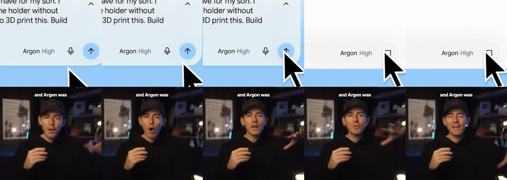

# v06_s20 · split_screenrec · 33.0–33.7s (calidad 4)

- **Guion:** And Argonne was able,
- **Qué se ve:** Arriba: cursor de flecha negro grande sobre el botón azul de enviar junto a «Argon High».
- **Diseño:** Subtítulo blanco sans bold (tipo Inter), 1–3 palabras, ~30 px sobre 720 (≈2,3 % del alto), centrado, y≈52,7 % (≈58 px bajo la costura, que está en y≈48,1 %); sin caja
- **Efectos:** Set oscuro con luces cian y ámbar desenfocadas; sin textura añadida
- **Animación:** Paneo rápido hasta el botón (≈0,3 s) y clic a ≈33.4
- **Por qué aquí:** «And Argon was able» → el clic marca el antes/después
