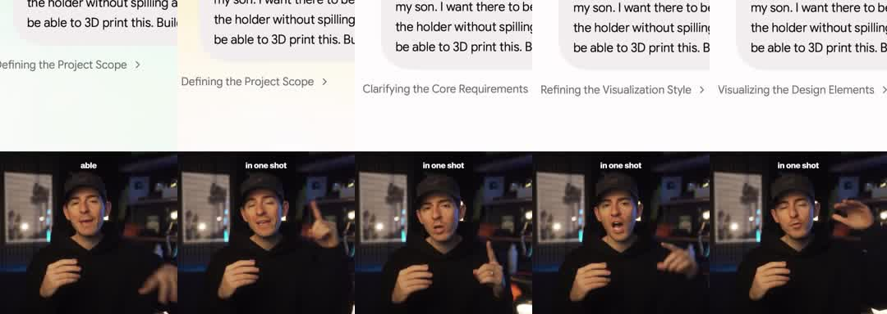

# v06_s21 · split_screenrec · 33.7–35.1s (calidad 3)

- **Guion:** in one shot, to
- **Qué se ve:** Arriba: respuesta en curso: fragmento del prompt y estados «Defining the Project Scope ›», «Refining the Visualization Style ›», «Visualizing the Design Elements ›».
- **Diseño:** Subtítulo blanco sans bold (tipo Inter), 1–3 palabras, ~30 px sobre 720 (≈2,3 % del alto), centrado, y≈52,7 % (≈58 px bajo la costura, que está en y≈48,1 %); sin caja
- **Efectos:** Set oscuro con luces cian y ámbar desenfocadas; sin textura añadida
- **Animación:** Corte interno suave (score 0.14) a 33.73; los estados cambian cada ~0,5 s
- **Por qué aquí:** «In one shot» → se ve al modelo pensando paso a paso
