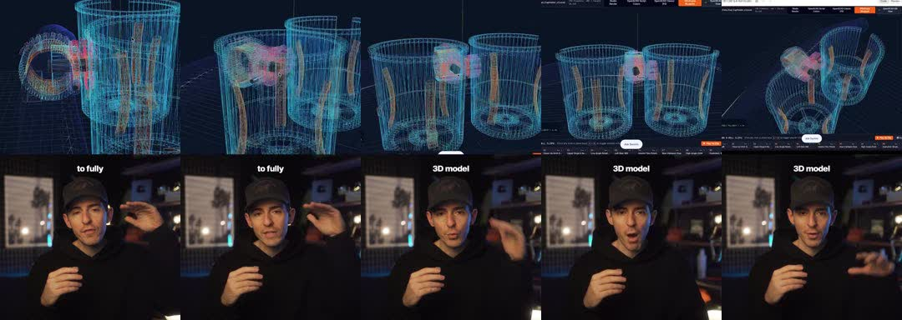

# v06_s22 · split_screenrec · 35.1–36.6s (calidad 5)

- **Guion:** fully 3D model the
- **Qué se ve:** Arriba: modelo 3D en malla azul (wireframe) de dos portavasos con abrazadera rosa, girando sobre fondo azul noche.
- **Diseño:** Subtítulo blanco sans bold (tipo Inter), 1–3 palabras, ~30 px sobre 720 (≈2,3 % del alto), centrado, y≈52,7 % (≈58 px bajo la costura, que está en y≈48,1 %); sin caja
- **Efectos:** Malla cian sobre azul oscuro
- **Animación:** Corte seco de entrada y salida (1 fotograma); rotación continua y zoom-out
- **Por qué aquí:** «To fully 3D model» → el resultado en 3D
