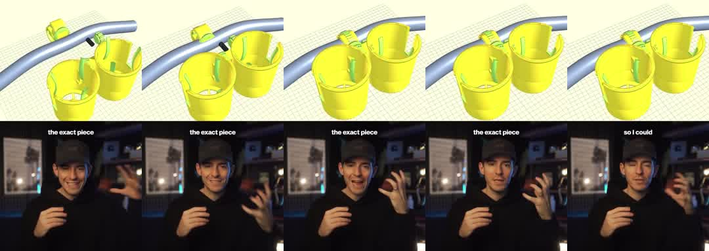

# v06_s23 · split_screenrec · 36.6–37.7s (calidad 5)

- **Guion:** exact piece so
- **Qué se ve:** Arriba: el mismo portavasos en sólido amarillo sobre fondo crema con rejilla, enganchado a un tubo gris.
- **Diseño:** Subtítulo blanco sans bold (tipo Inter), 1–3 palabras, ~30 px sobre 720 (≈2,3 % del alto), centrado, y≈52,7 % (≈58 px bajo la costura, que está en y≈48,1 %); sin caja
- **Efectos:** Set oscuro con luces cian y ámbar desenfocadas; sin textura añadida
- **Animación:** Corte seco de entrada y salida (1 fotograma)
- **Por qué aquí:** «The exact piece» → cambio de wireframe a sólido = pieza concreta
