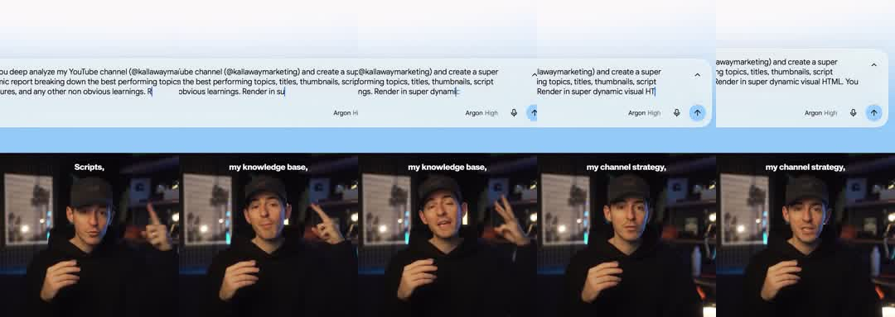

# v06_s26 · split_screenrec · 42.3–45.1s (calidad 3)

- **Guion:** Scripts, my knowledge base, my channel strategy.
- **Qué se ve:** Arriba: caja de prompt con el texto «Can you deep analyze my YouTube channel (@kallawaymarketing) and create a super dynamic report… Render in super dynamic visual HTML. You|».
- **Diseño:** Subtítulo blanco sans bold (tipo Inter), 1–3 palabras, ~30 px sobre 720 (≈2,3 % del alto), centrado, y≈52,7 % (≈58 px bajo la costura, que está en y≈48,1 %); sin caja
- **Efectos:** Set oscuro con luces cian y ámbar desenfocadas; sin textura añadida
- **Animación:** Corte seco de entrada y salida (1 fotograma); tecleo + paneo
- **Por qué aquí:** «Scripts, my knowledge base, my channel strategy» → lo que le pidió
