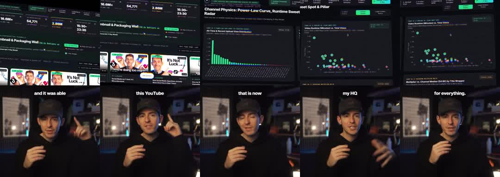

# v06_s27 · split_screenrec · 45.1–49.1s (calidad 5)

- **Guion:** It was able to build this YouTube dashboard that is now my HQ for everything.
- **Qué se ve:** Arriba: dashboard oscuro generado (cifras 16.6M+, 54,771, 2.86M; «Thumbnail & Packaging Wall» con miniaturas) visto en perspectiva; luego gráfico de barras verde «Channel Physics: Power-Law Curve…» (46.57) y un diagrama de dispersión (≈48.0).
- **Diseño:** Dashboard negro con acentos verde menta (#3DDC97 aprox.) y texto blanco. Subtítulo blanco sans bold (tipo Inter), 1–3 palabras, ~30 px sobre 720 (≈2,3 % del alto), centrado, y≈52,7 % (≈58 px bajo la costura, que está en y≈48,1 %); sin caja
- **Efectos:** Inclinación en perspectiva de la captura (rotación 3D ~10°)
- **Animación:** Corte seco de entrada y salida (1 fotograma); scroll continuo + corte interno a 46.57
- **Por qué aquí:** «Build this YouTube dashboard that is now my HQ» → el entregable final, lo más vistoso de la demo
