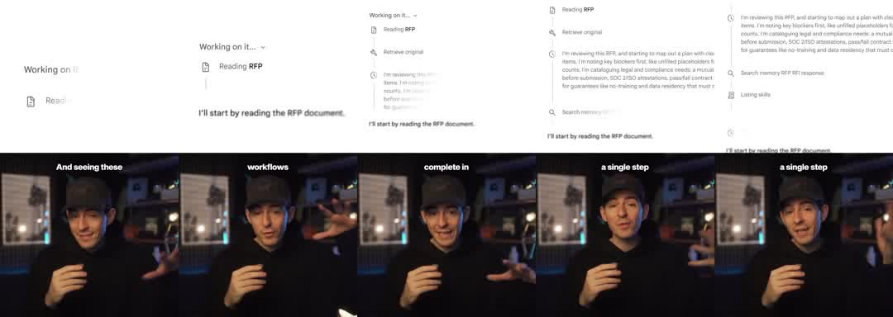

# v06_s28 · split_screenrec · 49.1–51.5s (calidad 3)

- **Guion:** And seeing these workflows complete in a single step is
- **Qué se ve:** Arriba: panel blanco de agente: «Working on it…», «Reading RFP», «Retrieve original», «I'll start by reading the RFP document.», pasos que van apareciendo.
- **Diseño:** Subtítulo blanco sans bold (tipo Inter), 1–3 palabras, ~30 px sobre 720 (≈2,3 % del alto), centrado, y≈52,7 % (≈58 px bajo la costura, que está en y≈48,1 %); sin caja
- **Efectos:** Set oscuro con luces cian y ámbar desenfocadas; sin textura añadida
- **Animación:** Corte seco (blanco total, score 0.99); pasos con fundido de ~0,3 s
- **Por qué aquí:** «Workflows complete in a single step» → pasos del agente ejecutándose
