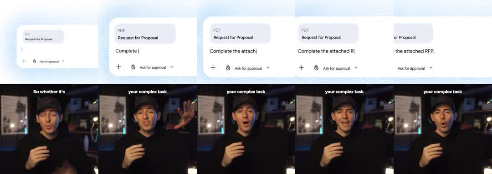

# v06_s39 · split_screenrec · 71.5–73.3s (calidad 3)

- **Guion:** So, whether it's your complex task or
- **Qué se ve:** Arriba: caja de agente con adjunto «PDF · Request for Proposal» y el texto «Complete the attached RFP|» tecleándose; botón «Ask for approval».
- **Diseño:** Subtítulo blanco sans bold (tipo Inter), 1–3 palabras, ~30 px sobre 720 (≈2,3 % del alto), centrado, y≈52,7 % (≈58 px bajo la costura, que está en y≈48,1 %); sin caja
- **Efectos:** Set oscuro con luces cian y ámbar desenfocadas; sin textura añadida
- **Animación:** Corte seco; la tarjeta entra con fundido en ~3 fotogramas
- **Por qué aquí:** «Whether it's your complex task» → la tarea del espectador
