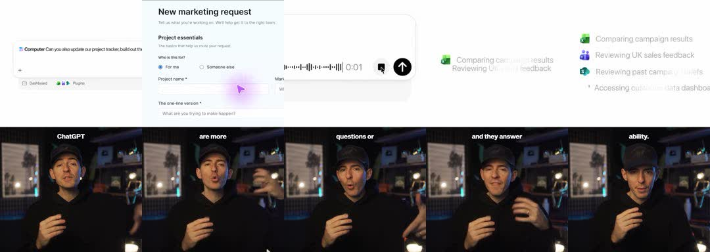

# v10_s16 · split_screenrec · 24.9–31.1s (calidad 4)

- **Guion:** ChatGPT and Codex are more reactive. You ask them questions or give them a task and they answer to the best of their ability.
- **Qué se ve:** Arriba 5 macros de interfaz seguidos: prompt 'Computer Can you also update our project tracker…', formulario 'New marketing request' con cursor morado, entrada de voz con onda 0:01, sugerencias 'Sites Build a landing page / Ask for approval', lista de actividad 'Comparing campaign results…'.
- **Diseño:** Split 50/50: grabación de pantalla recortada en macro (solo el fragmento de interfaz que importa, texto UI grande y legible), a sangre, sin marco de dispositivo salvo que se indique. Subtítulo: sans geométrica bold blanca, minúsculas con puntuación, ≈30 px de alto de letra sobre 720 px de ancho, centrado en x, 1–3 palabras, bajo la costura (y≈54 %).
- **Efectos:** Sin grano, papel ni halftone añadidos. A-roll: set oscuro, viñeta natural, prácticos cálidos y tubo/luz cian al fondo. Mitad superior sin filtros: el material conserva su color original (contraste fuerte con el set oscuro de abajo).
- **Animación:** La mitad superior entra por corte seco (1 fotograma) sincronizada con la palabra; los cambios internos también son cortes secos; el único movimiento es el propio del material (cámara del clip, scroll o zoom lento). La mitad inferior no corta (toma continua). Subtítulo por sustitución instantánea cada 1–3 palabras.
- **Por qué aquí:** 'reactive: you ask… they answer': cada verbo (ask, give a task, answer) con su trozo de interfaz en macro.
