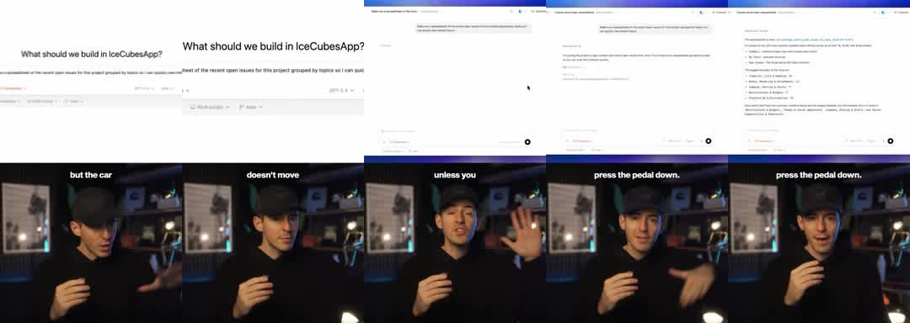

# v10_s18 · split_screenrec · 33.9–36.7s (calidad 3)

- **Guion:** the car doesn't move unless you press the pedal down.
- **Qué se ve:** Arriba Codex 'What should we build in IceCubesApp?' con zoom-in rápido al campo de texto y luego la conversación.
- **Diseño:** Split 50/50: grabación de pantalla recortada en macro (solo el fragmento de interfaz que importa, texto UI grande y legible), a sangre, sin marco de dispositivo salvo que se indique. Subtítulo: sans geométrica bold blanca, minúsculas con puntuación, ≈30 px de alto de letra sobre 720 px de ancho, centrado en x, 1–3 palabras, bajo la costura (y≈54 %).
- **Efectos:** Sin grano, papel ni halftone añadidos. A-roll: set oscuro, viñeta natural, prácticos cálidos y tubo/luz cian al fondo. Mitad superior sin filtros: el material conserva su color original (contraste fuerte con el set oscuro de abajo).
- **Animación:** La mitad superior entra por corte seco (1 fotograma) sincronizada con la palabra; los cambios internos también son cortes secos; el único movimiento es el propio del material (cámara del clip, scroll o zoom lento). La mitad inferior no corta (toma continua). Subtítulo por sustitución instantánea cada 1–3 palabras.
- **Por qué aquí:** 'the car doesn't move unless you press the pedal' → el prompt = el pedal.
