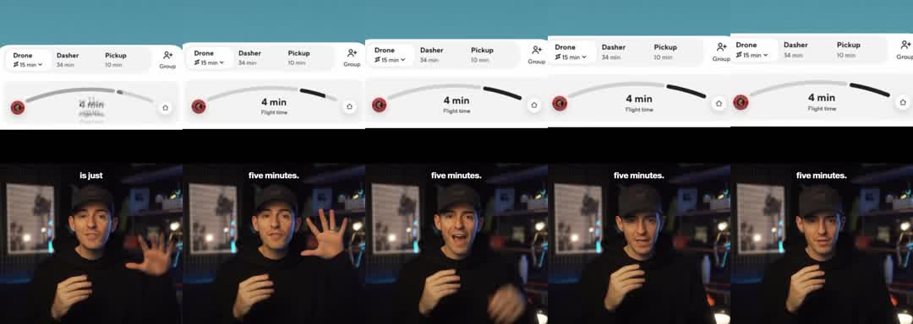

# v11_s12 · split_screenrec · 27.4–28.6s (calidad 4)

- **Guion:** just five minutes. The
- **Qué se ve:** Arriba franja de la app: pestañas 'Drone 15 min / Dasher 34 min / Pickup 10 min' y un arco con el tiempo de vuelo que baja de 11 min a 4 min; debajo banda negra hasta la costura.
- **Diseño:** Recorte de UI blanca de ≈37 % de alto (pestañas en sans negra ≈18 px, '4 min' bold ≈26 px) con banda negra hasta la costura (50.4 %). Subtítulo pequeño 'five minutes.' bajo la costura.
- **Efectos:** Sin grano, papel ni halftone añadidos. A-roll: set oscuro, viñeta natural, prácticos cálidos y tubo/luz cian al fondo. Mitad superior sin filtros: el material conserva su color original (contraste fuerte con el set oscuro de abajo).
- **Animación:** La mitad superior entra por corte seco (1 fotograma) sincronizada con la palabra; los cambios internos también son cortes secos; el único movimiento es el propio del material (cámara del clip, scroll o zoom lento). La mitad inferior no corta (toma continua). Subtítulo por sustitución instantánea cada 1–3 palabras.
- **Por qué aquí:** Dato numérico ('just five minutes') mostrado en la app real, comparado con Dasher 34 min.
