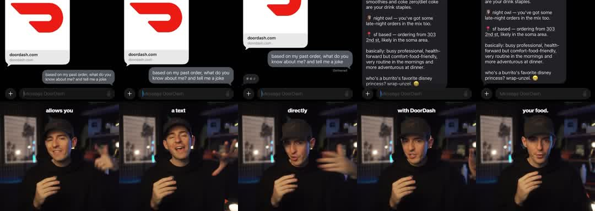

# v11_s20 · split_screenrec · 46.5–50.3s (calidad 4)

- **Guion:** And this allows you to have a text conversation directly with DoorDash to order your food.
- **Qué se ve:** Arriba chat de iMessage oscuro con DoorDash: tarjeta del enlace doordash.com con logo rojo, burbuja 'based on my past order, what do you know about me? and tell me a joke', y la respuesta larga que entra.
- **Diseño:** Split 47/53: grabación de pantalla recortada en macro (solo el fragmento de interfaz que importa, texto UI grande y legible), a sangre, sin marco de dispositivo salvo que se indique. Subtítulo: sans geométrica bold blanca, minúsculas con puntuación, ≈30 px de alto de letra sobre 720 px de ancho, centrado en x, 1–3 palabras, bajo la costura (y≈54 %).
- **Efectos:** Sin grano, papel ni halftone añadidos. A-roll: set oscuro, viñeta natural, prácticos cálidos y tubo/luz cian al fondo. Mitad superior sin filtros: el material conserva su color original (contraste fuerte con el set oscuro de abajo).
- **Animación:** La mitad superior entra por corte seco (1 fotograma) sincronizada con la palabra; los cambios internos también son cortes secos; el único movimiento es el propio del material (cámara del clip, scroll o zoom lento). La mitad inferior no corta (toma continua). Subtítulo por sustitución instantánea cada 1–3 palabras.
- **Por qué aquí:** 'have a text conversation directly with DoorDash': se ve la conversación real en la app de mensajes.
