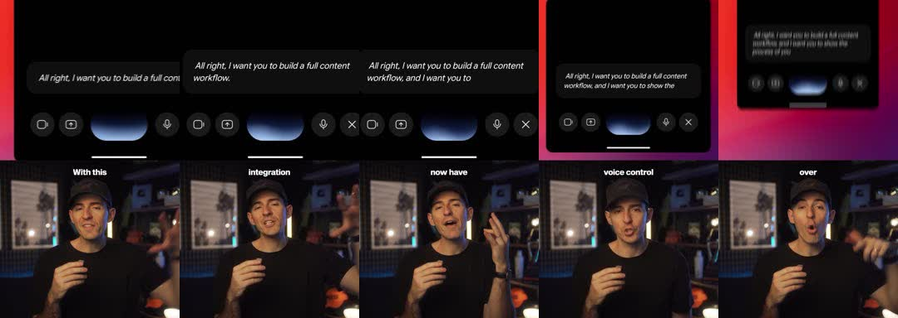

# v13_s07 · split_screenrec · 9.9–12.5s (calidad 5)

- **Guion:** With this integration, you can now have voice control over
- **Qué se ve:** Arriba primerísimo plano de la interfaz de Gemini Live: transcripción en itálica «All right, I want you to build a full content workflow, and I want you to show the process of you…» que se escribe palabra a palabra, y la barra de controles (cámara, compartir pantalla, orbe azul luminoso, micrófono, X). Desde 11,6 s la interfaz se aleja y queda como tarjeta negra sobre degradado rojo/magenta.
- **Diseño:** Pantalla dividida: evidencia arriba (0–50 %), él abajo en set oscuro (gorra y camiseta negras, luces naranja/cian desenfocadas). Costura recta sin borde en y≈645 px de 1280 (50,4 %). Subtítulo: sans geométrica bold blanca (tipo Inter/Helvetica Now Bold), minúsculas con mayúscula inicial de frase, ~30 px de alto de fuente sobre 720 px de ancho, 1–3 palabras, centrado en x, sombra negra suave. Subtítulo en y≈693 px (54 %), justo bajo la costura, sobre su gorra. Arriba: grabación de pantalla de Gemini en modo oscuro (fondo #000–#1E1F20, texto blanco/gris Google Sans), recortada muy de cerca para que el texto se lea.
- **Efectos:** Sin texturas. Texto secundario atenuado al ~40 % para dirigir la lectura.
- **Animación:** La captura nunca está quieta: scroll vertical continuo o zoom lento (~3–5 %/s). Entra y sale por corte seco.
- **Por qué aquí:** «control por voz» → se ve la voz convertida en texto en tiempo real: prueba literal de la función.
