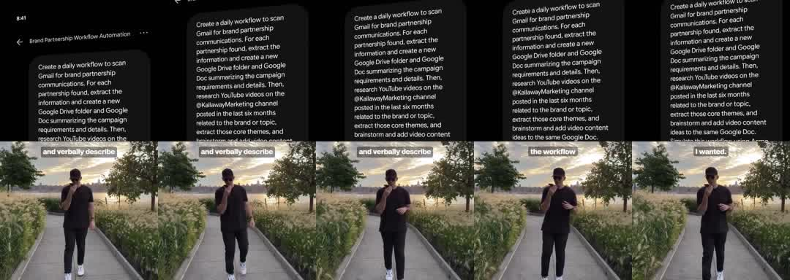

# v13_s17 · split_screenrec · 25.8–28.5s (calidad 5)

- **Guion:** and verbally describe the workflow I wanted. And
- **Qué se ve:** Split invertido de contenido: arriba el prompt largo en la burbuja del chat («Create a daily workflow to scan Gmail for brand partnership communications…»), abajo NO el set sino b-roll de él caminando hacia cámara por un sendero con hierba alta hablándole al móvil. Subtítulos «and verbally describe», «the workflow», «I wanted.».
- **Diseño:** Pantalla dividida: evidencia arriba (0–50 %), él abajo en set oscuro (gorra y camiseta negras, luces naranja/cian desenfocadas). Costura recta sin borde en y≈645 px de 1280 (50,4 %). Subtítulo: sans geométrica bold blanca (tipo Inter/Helvetica Now Bold), minúsculas con mayúscula inicial de frase, ~30 px de alto de fuente sobre 720 px de ancho, 1–3 palabras, centrado en x, sombra negra suave. Subtítulo en y≈693 px (54 %), justo bajo la costura, sobre su gorra. Arriba: grabación de pantalla de Gemini en modo oscuro (fondo #000–#1E1F20, texto blanco/gris Google Sans), recortada muy de cerca para que el texto se lea. Excepción: la mitad inferior es b-roll de exteriores, no el set.
- **Efectos:** Sin texturas. Texto secundario atenuado al ~40 % para dirigir la lectura.
- **Animación:** La captura nunca está quieta: scroll vertical continuo o zoom lento (~3–5 %/s). Entra y sale por corte seco.
- **Por qué aquí:** «describí verbalmente» → abajo se le ve hablando al móvil y arriba el texto resultante: causa y efecto en un solo encuadre.
