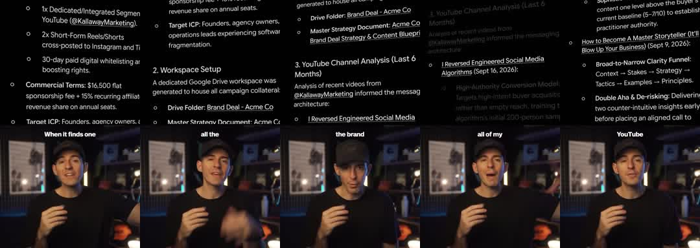

# v13_s22 · split_screenrec · 36.0–42.4s (calidad 4)

- **Guion:** When it finds one, it extracts all the campaign information shared by the brand, and then it searches all of my best content on YouTube to
- **Qué se ve:** Arriba el mismo documento en scroll continuo durante 6,4 s: Campaign Deliverables → Commercial Terms → «2. Workspace Setup» (Drive Folder: Brand Deal – Acme Co) → «3. YouTube Channel Analysis (Last 6 Months)» → lista de videos con enlaces subrayados. Abajo él. Subtítulos de «When it finds one» a «YouTube».
- **Diseño:** Pantalla dividida: evidencia arriba (0–50 %), él abajo en set oscuro (gorra y camiseta negras, luces naranja/cian desenfocadas). Costura recta sin borde en y≈645 px de 1280 (50,4 %). Subtítulo: sans geométrica bold blanca (tipo Inter/Helvetica Now Bold), minúsculas con mayúscula inicial de frase, ~30 px de alto de fuente sobre 720 px de ancho, 1–3 palabras, centrado en x, sombra negra suave. Subtítulo en y≈693 px (54 %), justo bajo la costura, sobre su gorra. Arriba: grabación de pantalla de Gemini en modo oscuro (fondo #000–#1E1F20, texto blanco/gris Google Sans), recortada muy de cerca para que el texto se lea.
- **Efectos:** Sin texturas. Texto secundario atenuado al ~40 % para dirigir la lectura.
- **Animación:** La captura nunca está quieta: scroll vertical continuo o zoom lento (~3–5 %/s). Entra y sale por corte seco.
- **Por qué aquí:** Explica el proceso paso a paso: el scroll acompaña la narración como un teleprompter de pruebas.
