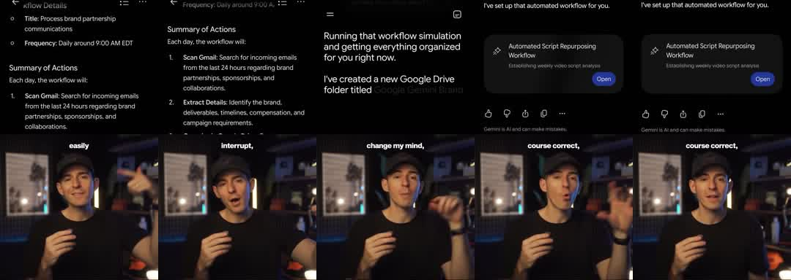

# v13_s45 · split_screenrec · 96.0–98.7s (calidad 4)

- **Guion:** interrupt, change my mind, course correct,
- **Qué se ve:** Arriba tres pantallas rápidas: (95,98 s) «Summary of Actions» con scroll; (96,98 s) respuesta «Running that workflow simulation and getting everything organized for you right now. I've created a new Google Drive folder titled…» en streaming; (98,02 s) tarjeta «Automated Script Repurposing Workflow [Open]». Subtítulos «easily», «interrupt,», «change my mind,», «course correct,».
- **Diseño:** Pantalla dividida: evidencia arriba (0–50 %), él abajo en set oscuro (gorra y camiseta negras, luces naranja/cian desenfocadas). Costura recta sin borde en y≈645 px de 1280 (50,4 %). Subtítulo: sans geométrica bold blanca (tipo Inter/Helvetica Now Bold), minúsculas con mayúscula inicial de frase, ~30 px de alto de fuente sobre 720 px de ancho, 1–3 palabras, centrado en x, sombra negra suave. Subtítulo en y≈693 px (54 %), justo bajo la costura, sobre su gorra. Arriba: grabación de pantalla de Gemini en modo oscuro (fondo #000–#1E1F20, texto blanco/gris Google Sans), recortada muy de cerca para que el texto se lea.
- **Efectos:** Sin texturas. Texto secundario atenuado al ~40 % para dirigir la lectura.
- **Animación:** La captura nunca está quieta: scroll vertical continuo o zoom lento (~3–5 %/s). Entra y sale por corte seco.
- **Por qué aquí:** Tres verbos → tres pantallas: el ritmo de cortes imita 'cambiar de idea'.
