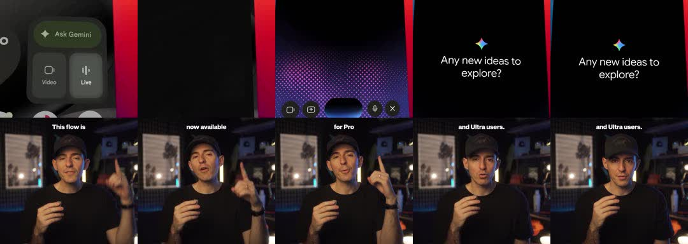

# v13_s52 · split_screenrec · 113.4–116.3s (calidad 4)

- **Guion:** This flow is now available for pro and ultra users. Comment
- **Qué se ve:** Arriba widget de Android («68°», «Ask Gemini», botones «Video» y «Live») con zoom al botón «Live»; fundido a negro y aparece la interfaz de Gemini Live (orbe azul, «Tap to interrupt») y luego «Any new ideas to explore?» con la chispa. Franja roja vertical en el borde derecho. Subtítulos «This flow is», «now available», «for Pro», «and Ultra users.».
- **Diseño:** Pantalla dividida: evidencia arriba (0–50 %), él abajo en set oscuro (gorra y camiseta negras, luces naranja/cian desenfocadas). Costura recta sin borde en y≈645 px de 1280 (50,4 %). Subtítulo: sans geométrica bold blanca (tipo Inter/Helvetica Now Bold), minúsculas con mayúscula inicial de frase, ~30 px de alto de fuente sobre 720 px de ancho, 1–3 palabras, centrado en x, sombra negra suave. Subtítulo en y≈693 px (54 %), justo bajo la costura, sobre su gorra. Arriba: grabación de pantalla de Gemini en modo oscuro (fondo #000–#1E1F20, texto blanco/gris Google Sans), recortada muy de cerca para que el texto se lea.
- **Efectos:** Sin texturas. Texto secundario atenuado al ~40 % para dirigir la lectura.
- **Animación:** La captura nunca está quieta: scroll vertical continuo o zoom lento (~3–5 %/s). Entra y sale por corte seco.
- **Por qué aquí:** Disponibilidad → enseña exactamente dónde se pulsa para empezar.
