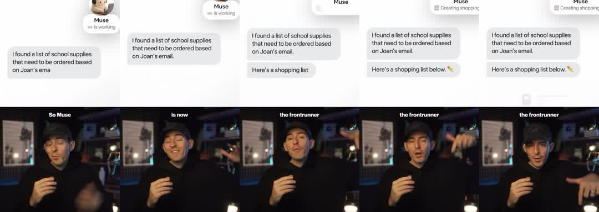

# v14_s26 · split_screenrec · 41.2–42.8s (calidad 3)

- **Guion:** So Muse is now the front runner
- **Qué se ve:** Arriba chat: avatar «Muse — is working», burbuja gris «I found a list of school supplies that need to be ordered based on Joan's email.» y «Here's a shopping list below.». Subtítulos «So Muse», «is now», «the frontrunner».
- **Diseño:** Pantalla dividida: evidencia arriba, él abajo en set oscuro (gorra y sudadera con capucha negras, bokeh cálido y cian). Costura recta sin borde en y=646 px de 1280 (50,5 %). Subtítulo: sans bold blanca (tipo Inter/Helvetica Now Bold) ~30 px de alto de fuente sobre 720 px de ancho, 1–3 palabras, centrado en x, sombra negra suave. Subtítulo en y≈693 px (54 %), justo bajo la costura. Arriba: animación de interfaz clara (fondo blanco/gris #F2F3F5, burbujas de chat azul claro y gris, tipografía sans redondeada).
- **Efectos:** Sin texturas; sombras suaves de tarjeta.
- **Animación:** La UI siempre se mueve: zoom-in a la burbuja, texto que se escribe, scroll; corte seco.
- **Por qué aquí:** El agente haciendo una tarea concreta.
