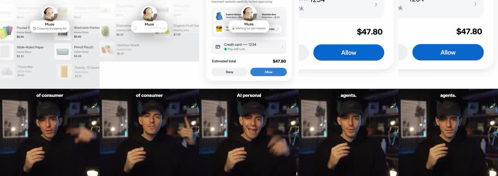

# v14_s27 · split_screenrec · 42.8–45.1s (calidad 4)

- **Guion:** of consumer AI personal agents.
- **Qué se ve:** Arriba rejilla de productos de compra, luego tarjeta de pago («Credit card •••• 1234», «Estimated total $47.80», botones Deny/Allow) con zoom al botón azul «Allow». Subtítulos «of consumer», «AI personal», «agents.».
- **Diseño:** Pantalla dividida: evidencia arriba, él abajo en set oscuro (gorra y sudadera con capucha negras, bokeh cálido y cian). Costura recta sin borde en y=646 px de 1280 (50,5 %). Subtítulo: sans bold blanca (tipo Inter/Helvetica Now Bold) ~30 px de alto de fuente sobre 720 px de ancho, 1–3 palabras, centrado en x, sombra negra suave. Subtítulo en y≈693 px (54 %), justo bajo la costura. Arriba: animación de interfaz clara (fondo blanco/gris #F2F3F5, burbujas de chat azul claro y gris, tipografía sans redondeada).
- **Efectos:** Sin texturas; sombras suaves de tarjeta.
- **Animación:** La UI siempre se mueve: zoom-in a la burbuja, texto que se escribe, scroll; corte seco.
- **Por qué aquí:** «agentes» → el agente a punto de pagar: el momento de mayor consecuencia.
