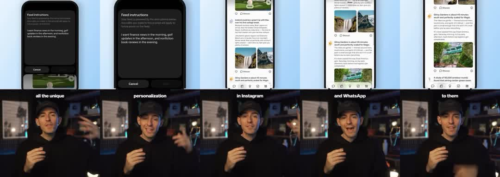

# v14_s29 · split_screenrec · 46.2–51.5s (calidad 3)

- **Guion:** all the unique personalization Meta has in Instagram, Facebook and WhatsApp that is unique to them.
- **Qué se ve:** Arriba mockup de teléfono sobre azul claro: diálogo oscuro «Feed instructions» con texto («I want finance news in the morning, golf updates in the afternoon, and nonfiction book reviews in the evening.»); en 48,29 s pasa a un feed blanco con publicaciones y fotos (cascada, jardín) que hace scroll. Subtítulos «all the unique», «personalization», «Meta has», «in Instagram», «Facebook», «and WhatsApp», «that is unique», «to them».
- **Diseño:** Pantalla dividida: evidencia arriba, él abajo en set oscuro (gorra y sudadera con capucha negras, bokeh cálido y cian). Costura recta sin borde en y=646 px de 1280 (50,5 %). Subtítulo: sans bold blanca (tipo Inter/Helvetica Now Bold) ~30 px de alto de fuente sobre 720 px de ancho, 1–3 palabras, centrado en x, sombra negra suave. Subtítulo en y≈693 px (54 %), justo bajo la costura. Arriba: animación de interfaz clara (fondo blanco/gris #F2F3F5, burbujas de chat azul claro y gris, tipografía sans redondeada).
- **Efectos:** Sin texturas; sombras suaves de tarjeta.
- **Animación:** La UI siempre se mueve: zoom-in a la burbuja, texto que se escribe, scroll; corte seco.
- **Por qué aquí:** «personalización» → instrucciones del feed. Nota: no aparecen logos de Instagram/Facebook/WhatsApp al nombrarlos.
