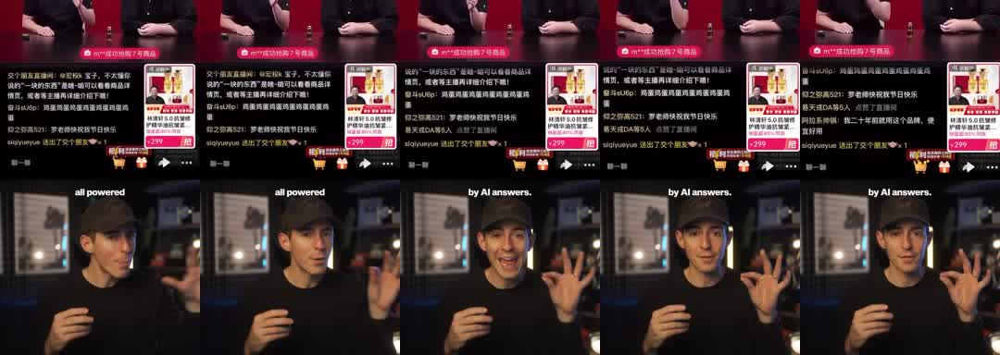

# v15_s39 · split_screenrec · 52.7–54.5s (calidad 3)

- **Guion:** all powered by AI answers.
- **Qué se ve:** Arriba zoom a la zona de comentarios del directo (texto blanco y naranja sobre negro, ficha de producto a la derecha). Abajo él. Subtítulos «all powered», «by AI answers.».
- **Diseño:** Pantalla dividida: evidencia arriba, él abajo en set oscuro (gorra y camiseta negras, tubo de luz cálida a la derecha). Costura recta sin borde en y=649 px de 1280 (50,7 %). Subtítulo: sans bold blanca (tipo Inter/Helvetica Now Bold) ~30 px de alto de fuente sobre 720 px de ancho, 1–3 palabras, centrado en x, sombra negra suave. Subtítulo en y≈693 px (54 %), justo bajo la costura. Arriba: grabación de pantalla del directo ampliada a la zona de comentarios (fondo negro, texto blanco y naranja en chino).
- **Efectos:** Sin texturas.
- **Animación:** Scroll del chat propio de la grabación; corte seco.
- **Por qué aquí:** Acerca la prueba: se leen (en chino) los mensajes.
