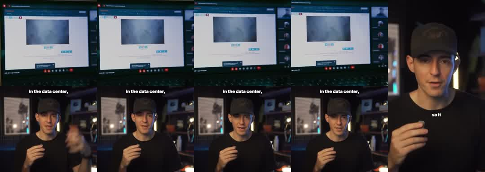

# v16_s34 · split_screenrec · 57.3–58.0s (calidad 2)

- **Guion:** the data center,
- **Qué se ve:** Arriba pantalla de videollamada con una imagen submarina compartida y miniaturas de participantes. Subtítulo «in the data center,».
- **Diseño:** Pantalla dividida: evidencia arriba, él abajo en set oscuro (gorra y camiseta negras, tubo de luz cálida a la derecha, luz cian a la izquierda). Costura recta sin borde en y≈639 px de 1280 (49,9 %). Subtítulo: sans bold blanca (tipo Inter/Helvetica Now Bold) ~30 px de alto de fuente sobre 720 px de ancho, 1–3 palabras, centrado en x, sombra negra suave. Subtítulo en y≈680 px (53 %), justo bajo la costura. Arriba: pantalla de dispositivo (móvil en mano con chat, ventana de navegador con cursor).
- **Efectos:** Sin texturas.
- **Animación:** Movimiento de mano/cursor; corte seco.
- **Por qué aquí:** Variación rápida.
